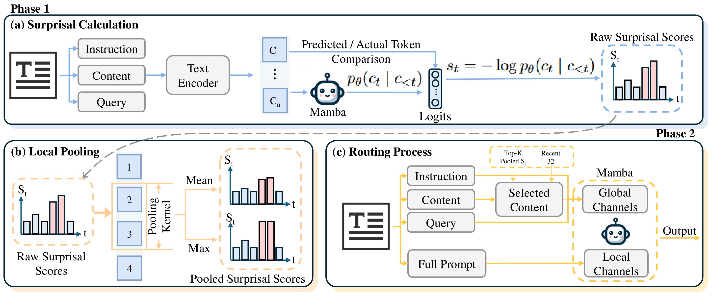

# SuPER-Mamba

**SuPER-Mamba: Surprisal-guided Position Evaluation and Routing for Mamba**

SuPER-Mamba is a training-free approach for improving the long-context capabilities of pretrained Mamba models. It leverages the model's own predictive feedback to identify informative context positions and selectively control long-range state updates through Surprisal-guided Routing, without requiring additional training.

**Paper:** arXiv link coming soon.

## Overview

<p align="center">
  
</p>

<p align="center">
  <em>Overview of SuPER-Mamba. The first phase estimates Surprisal and performs local aggregation, while the second phase uses the resulting position scores to guide selective state updates and generate responses.</em>
</p>

SuPER-Mamba uses **Surprisal** to measure how unexpected an input is under the pretrained model's predictive distribution. This signal provides a query-independent basis for identifying context positions that may contain important information.

The framework consists of two stages:

1. **Offline Surprisal Estimation and Local Aggregation.** A first model pass computes Surprisal from the pretrained Mamba model's predictions. Local pooling and denoising are then applied to obtain more stable position scores.

2. **Surprisal-guided Routing and Generation.** The aggregated scores are used to select the Top-K historical context positions, together with a preserved window of the most recent 32 positions. These selections guide Global Channel state updates, while Local Channels process the complete input. Instructions and queries are preserved in both channels.

SuPER-Mamba requires neither additional selector training nor updates to pretrained model parameters. Its two-pass inference procedure separates offline position evaluation from subsequent response generation.

This repository provides the **Mamba2-1.3B implementation** and the LongBench-E evaluation pipeline used in our experiments.

## Installation

### Tested Environment

The following environment has been verified:

| Component | Version |
|---|---|
| Operating System | Ubuntu 22.04 |
| GPU | NVIDIA RTX A4000 (16 GB) |
| Python | 3.10.20 |
| PyTorch | 2.5.0+cu124 |
| CUDA Toolkit | 12.4.131 |
| NVIDIA Driver | 595.84 |
| GCC | 11.4.0 |
| causal-conv1d | 1.5.0.post8 |
| mamba-ssm | 2.2.4 |

Other hardware and software configurations may also work but have not been fully validated.

### Setup

Clone the repository:

```bash
git clone https://github.com/haveasmileYEAH/SuPER-Mamba.git
cd SuPER-Mamba
```

Create and activate a Python 3.10 environment:

```bash
conda create -n super-mamba python=3.10 -y
conda activate super-mamba
```

Install the required dependencies:

```bash
bash setup.sh
```

The setup script installs PyTorch, the required Python packages, and the CUDA extensions in the appropriate order. It also retrieves the Mamba implementation and precomputed channel information required for inference.

If the dependencies are already installed in a compatible environment, use:

```bash
bash setup.sh --skip-deps
```

The required third-party implementation is downloaded into `third_party/lamb/` at a fixed upstream commit. Third-party source files and precomputed tensors are not included directly in this repository.

## Evaluation

### Benchmark

The current release supports the official Mamba2-1.3B evaluation on LongBench-E.

| Item | Configuration |
|---|---|
| Model | `state-spaces/mamba2-1.3b` |
| Benchmark | LongBench-E |
| Datasets | 13 |
| Total Samples | 3,668 |
| Selection Signal | Offline Surprisal |
| Local Aggregation | Mean / Max Pooling |
| Historical Selection | Top-K |
| Recent Preservation | 32 positions |
| Additional Training | None |

Dataset-specific Top-K budgets, pooling kernels, and pooling types are fixed according to the main experimental configuration:

```text
configs/category_frozen_full_selection.json
```

These settings are not adjusted during evaluation.

### Run LongBench-E

Run the complete evaluation using the default single-worker configuration:

```bash
bash scripts/run_full_longbench_e.sh
```

Alternatively, specify the GPU and number of workers:

```bash
bash scripts/run_full_longbench_e.sh \
    --device 0 \
    --workers 3
```

A single worker is used by default to reduce the risk of CUDA out-of-memory errors during long-context inference. Running multiple workers on the same GPU may require additional GPU memory.

The pretrained model and benchmark data may be downloaded automatically during the first run.

### Outputs

Evaluation outputs are saved by default to:

```text
results/mamba2_full/
```

The evaluation pipeline saves per-sample predictions and aggregates the results after all samples have been processed.

The final summary is written to:

```text
results/mamba2_full/full_summary.csv
```

Prediction files, logs, and model caches are excluded from the public Git repository.

## Results

The following results are reported for Mamba2-1.3B on the full LongBench-E benchmark.

| Method | LongBench-E Macro Average |
|---|---:|
| Vanilla Mamba2 | 8.09 |
| **SuPER-Mamba** | **21.56** |

SuPER-Mamba improves the overall long-context performance of pretrained Mamba2 across 13 LongBench-E datasets, comprising 3,668 evaluation samples, without additional training.

This repository provides the evaluation implementation and frozen experimental configurations. Precomputed prediction files are not included.

## Repository Structure

```text
SuPER-Mamba/
├── assets/
│   └── framework.png
├── configs/
│   ├── category_frozen_full_selection.json
│   └── mamba2-1.3b_topk1024_pk9.json
├── scripts/
│   ├── run_longbench_e.py
│   └── run_full_longbench_e.sh
├── super_mamba/
│   ├── mamba2_runtime.py
│   ├── surprisal_pipeline.py
│   └── routing.py
├── .gitignore
├── requirements.txt
├── setup.sh
└── README.md
```

The main components are:

- `super_mamba/mamba2_runtime.py`: Mamba2 runtime, channel-level state updates, and generation-related utilities.
- `super_mamba/surprisal_pipeline.py`: Surprisal estimation and associated processing utilities.
- `super_mamba/routing.py`: Position selection and routing-related utilities.
- `scripts/run_longbench_e.py`: Main LongBench-E evaluation entry point.
- `scripts/run_full_longbench_e.sh`: Script for running and aggregating the complete evaluation.
- `configs/category_frozen_full_selection.json`: Frozen dataset-specific experimental settings.

## Acknowledgements

This project builds upon the following open-source resources:

- [Mamba](https://github.com/state-spaces/mamba)
- [LAMB](https://github.com/GATECH-EIC/LAMB)
- [LongBench](https://github.com/THUDM/LongBench)

We thank the respective authors for making their models, implementations, and evaluation resources publicly available.

The third-party Mamba implementation used by this repository is pinned to LAMB commit `b3ce2a9476b46fb1e28b5572a39b82e7da3dc519`.

## Citation

If you find SuPER-Mamba useful in your research, please consider citing our paper.

The BibTeX entry will be added once the preprint is publicly available.
